# AI 助手面板：界面与交互改版方案

> 日期 2026-10-31。只是方案和静态效果图，**没有改任何应用代码**，没有调用 AWS，也没有用本机凭证。
> 效果图是 `docs/plans/ai-ux-mocks/*.html`（纯 HTML + CSS，取 `styles.css` 的 token），由 headless Chromium 以 2x 截成 `png/`。
> 「Before」一图直接引用 `src/renderer/src/styles.css` 和组件真实的 class，所以是当前样式本身；里面的内容是演示数据。
> 改版**只动展示和交互**：卡片仍由主进程生成，审批和提案仍只认 system 卡片上的按钮，参数、hash、二次确认、确认文字、1 秒延迟启用都不变。需要后端配合的地方单独列在 §4。

## 0. 一页结论

**最重要的 5 个改动**

1. **把工具调用折成每轮一个「Activity」**：一行写「✓ 3 步 · 查询 EC2 实例、运行脚本、查询指标 · 4.8 秒」，默认收起，展开后是带状态和耗时的步骤列表，`run_script` 再展开看调用次数和代码。（图 03、04）
2. **审批能用键盘处理**：焦点在审批卡上时 `↵` 允许一次、`Esc` 拒绝。焦点只会因为用户自己的操作落到卡上，`↵` 仍要等 1 秒后才生效。输入框上方用一行状态说明「回答已暂停」，代替顶部横幅和工具行的重复提示。（图 05）
3. **输入框改成一个带工具栏的框**：高度自动增长，`↑` 调出历史，`/` 命令，`@` 上下文标签，常驻的「服务商 · 模型」切换，发送和停止共用一个按钮。用量从两行常驻文字收进一个小数字和模型弹窗。（图 07）
4. **错误能重试，回答能重新生成，问题能编辑后重发**：失败的回答显示成就地的错误块，附「重试 / 换个模型重试 / 复制错误」；停止的回答可以「重新生成」；用户消息可以「编辑并重发」。（图 10，需要后端）
5. **对话列表换成弹层**：带搜索，有置顶，按今天 / 昨天 / 最近 7 天分组，显示「正在运行 · 等待审批」状态；标题栏从两行（82px）减到一行（40px）。空状态按当前页面生成建议问题。（图 02、08）

另外修一个现有 bug（§2 #1）：400px 宽时表格卡片的固定「操作」列盖住了右侧的数字列，在 Before 图里「CPU 1h」只剩「CF」。

**效果图**

| # | 内容 | 文件 |
| --- | --- | --- |
| 01 | Before / After 同一段对话 | 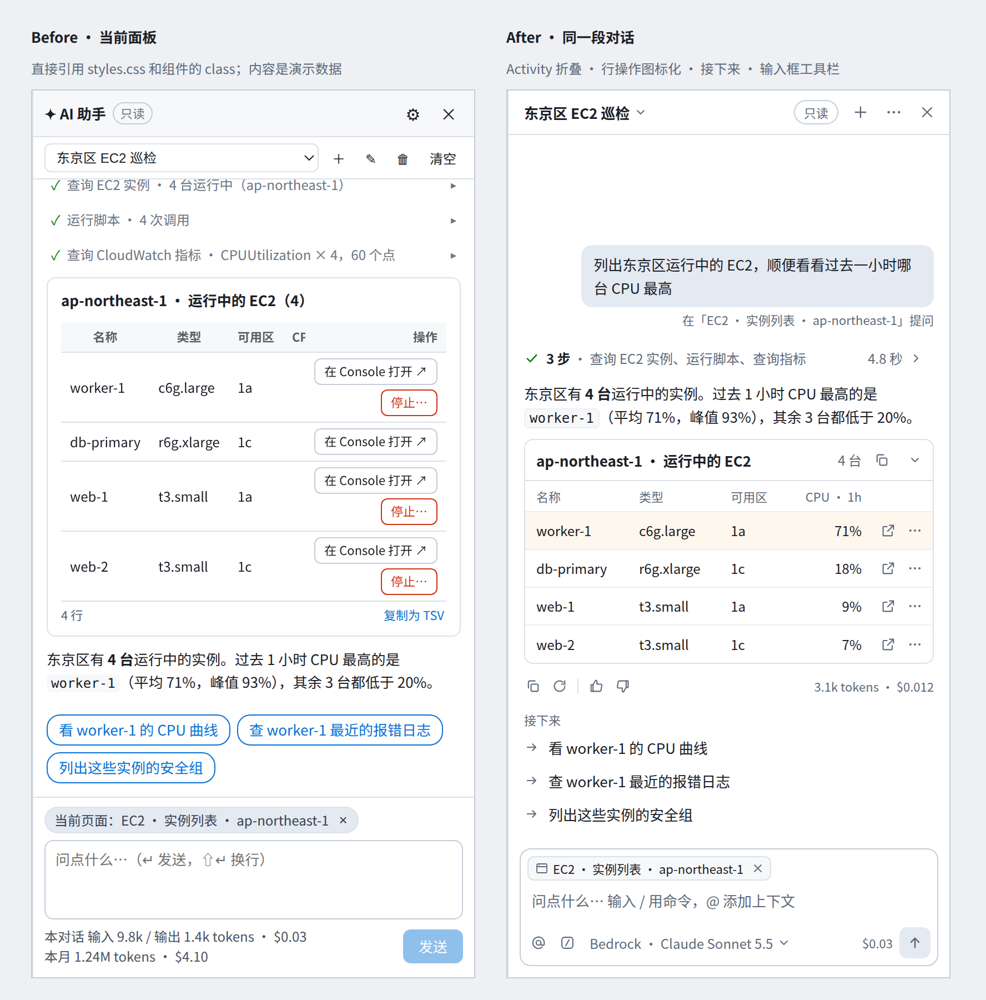 |
| 02 | 空状态：按当前页面生成建议 | 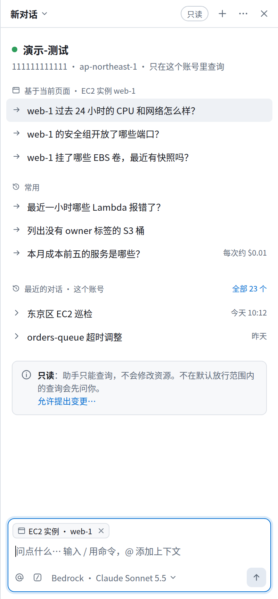 |
| 03 | 对话：折叠的 Activity + 表格卡片 + 接下来 | 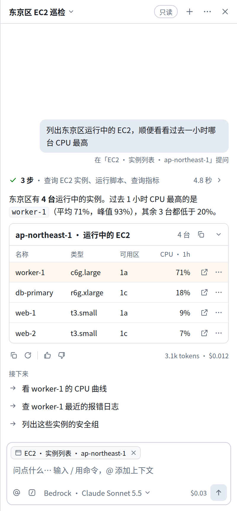 |
| 04 | 展开的 Activity：步骤、脚本调用与代码，回答正在流式生成 | 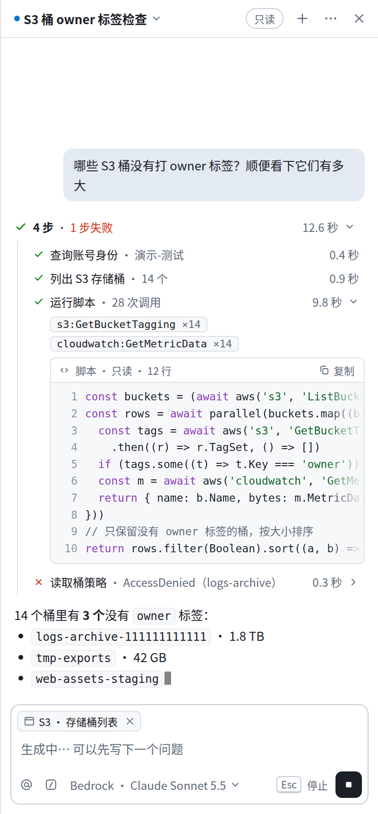 |
| 05 | 行内审批：键盘提示 | 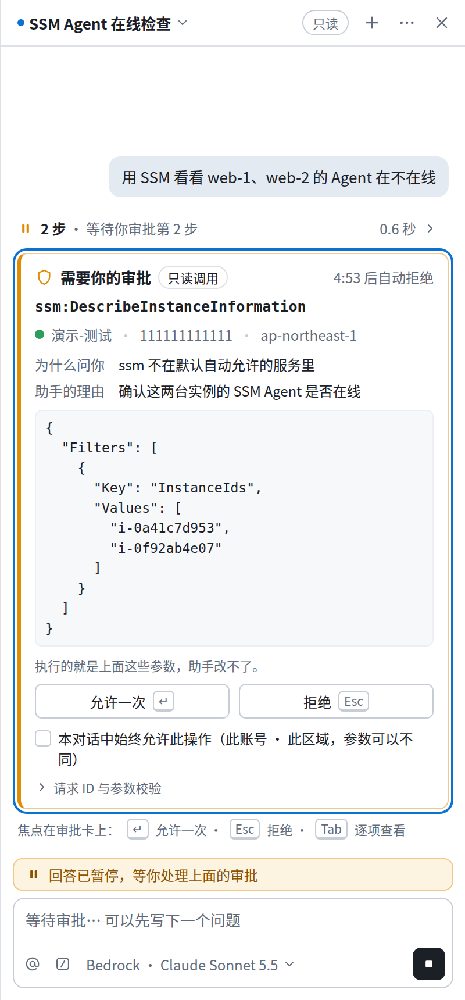 |
| 06 | 变更提案：审阅 / 最终确认 | 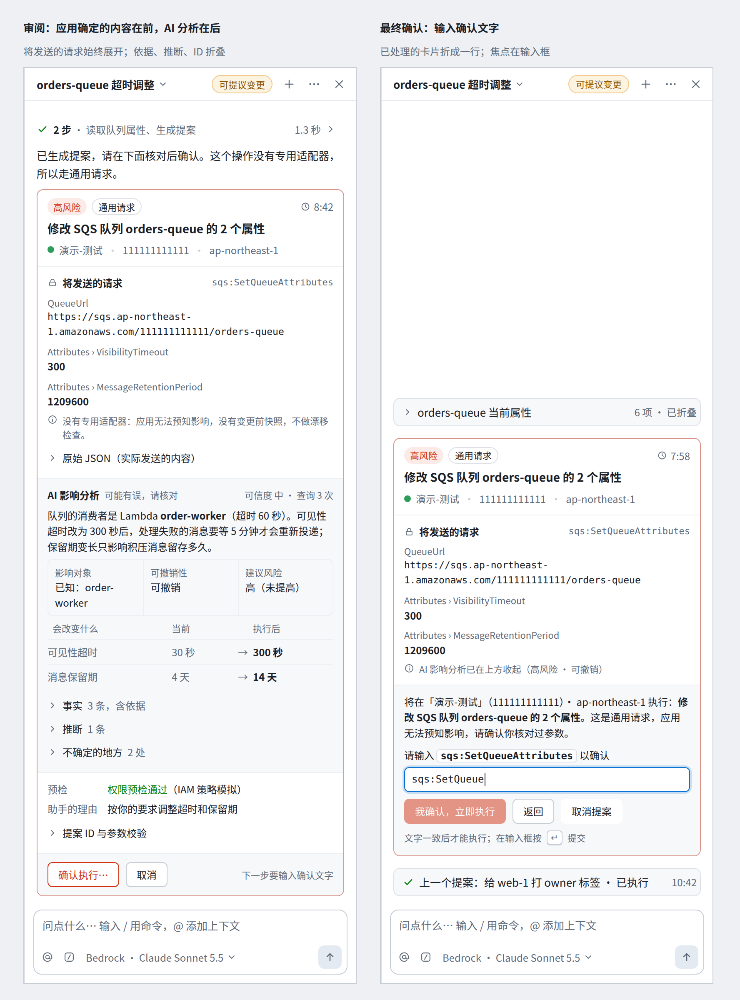 |
| 07 | 输入框：`/` 命令、`@` 上下文、模型切换 | 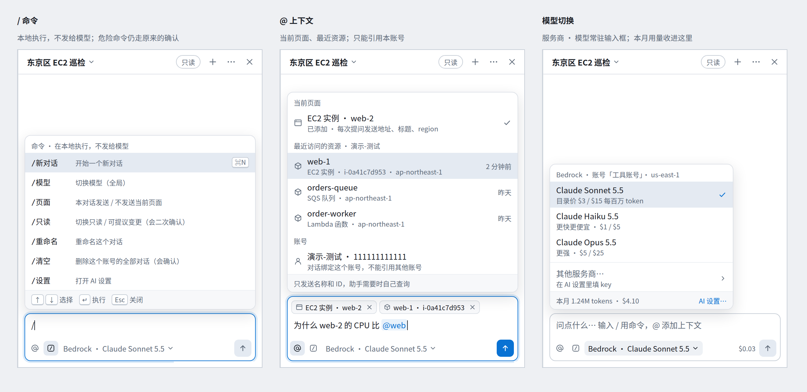 |
| 08 | 对话列表：搜索、置顶、按日期分组 | 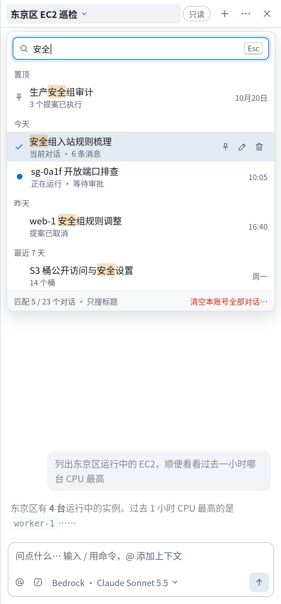 |
| 09 | 宽度 320 / 520（图 03 同一份 HTML） | 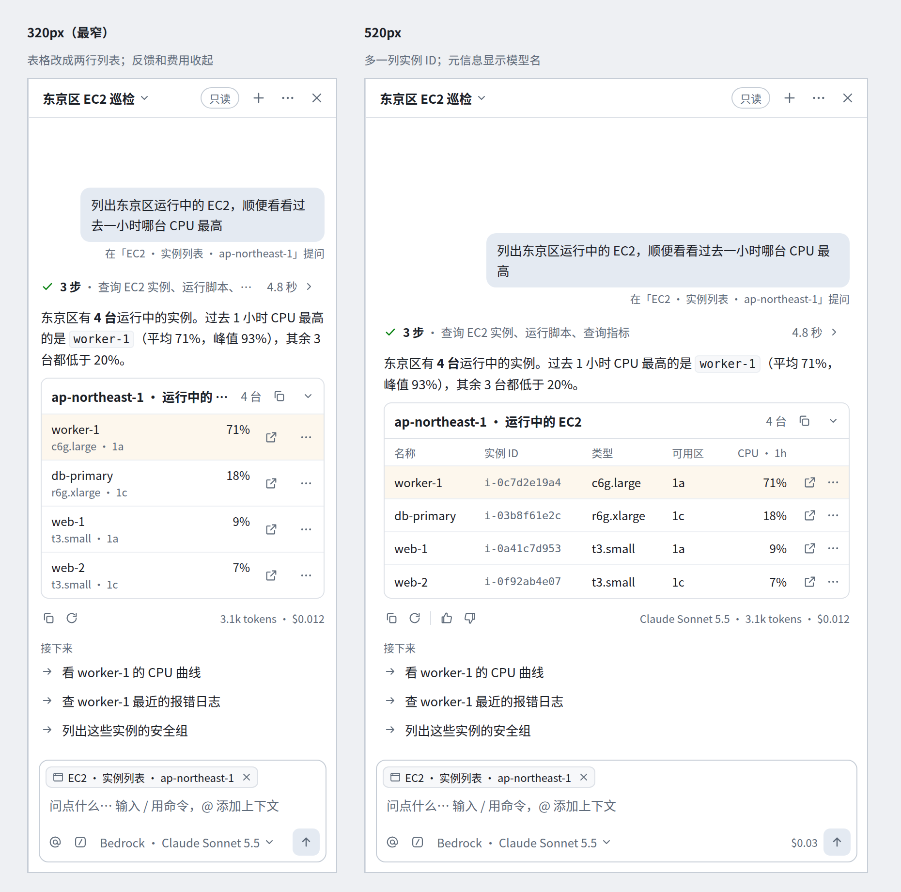 |
| 10 | 错误、停止与重试 | 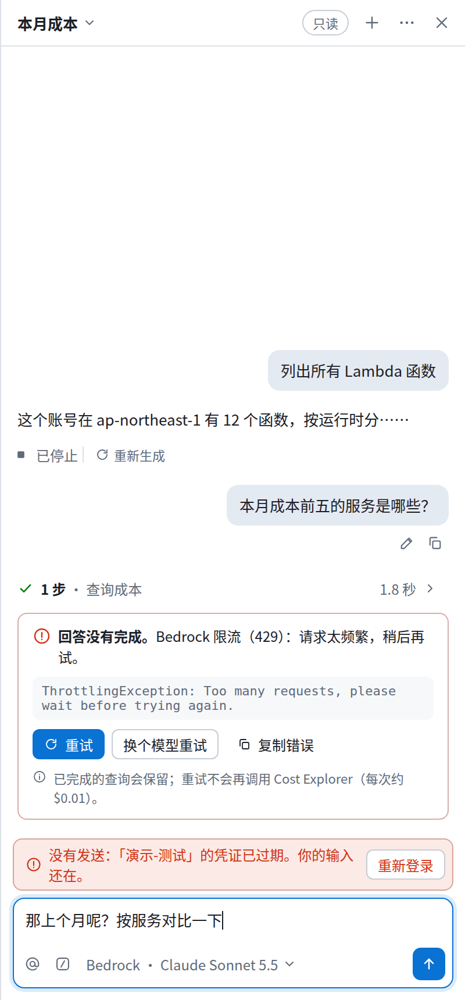 |
| 11 | 深色（只换 token，验证没有写死的颜色；不在本次范围） | 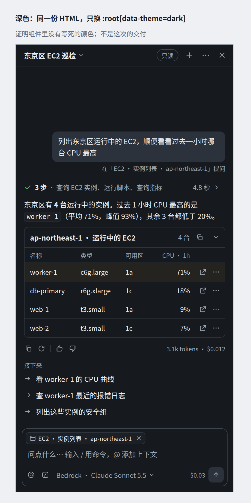 |

---

## 1. 调研

方法：用 WebFetch 直接读各项目的官方文档、GitHub 源码和 keymap（这次没有搜索工具）。**[已核实]** 表示在所列页面上读到；**[推断]** 表示来自记忆或间接来源，没在页面上核实。WebFetch 会先把页面摘要一遍，所以下面引号里的文字是摘要里的原文，不是逐字抓取。

### 1.1 逐个项目

**Open WebUI**
- 侧栏日期分组用 `getTimeRange`：Today / Yesterday / Previous 7 days / Previous 30 days，再往前按月、按年。[已核实] https://raw.githubusercontent.com/open-webui/open-webui/main/src/lib/utils/index.ts
- 推理块可以折叠：生成中显示「Thinking...」，结束后显示「Thought for N seconds」；代码执行显示「Analyzing... / Analyzed」。[已核实] https://raw.githubusercontent.com/open-webui/open-webui/main/src/lib/components/common/Collapsible.svelte
- 快捷键：`Esc` 停止生成，`↑` 编辑上一条，`⌘R` 重新生成，`⌘⇧C` 复制最后一条回答；**允许工具调用 `⌘⌥↵`、拒绝 `⌘⌥⌫`**；`/` 提示词、`@` 模型、`#` 知识库。[已核实] https://docs.openwebui.com/features/chat-conversations/chat-features/keyboard-shortcuts
- 后续问题以芯片显示在回答下面，第一条还会作为灰色幽灵文字出现在空输入框里，`Tab` 采纳。[已核实] https://docs.openwebui.com/features/chat-conversations/chat-features/follow-up-prompts
- 消息队列：生成时可以继续输入并排队。[已核实] https://docs.openwebui.com/features/chat-conversations/chat-features/message-queue

**LibreChat**
- 消息操作栏在悬停或获得焦点时出现，**流式生成时不显示**：复制、编辑、分叉、反馈、重新生成、继续。编辑时 `⌘↵` 重新运行，`Esc` 取消。[已核实] https://www.librechat.ai/docs/features/message_actions
- 输入框符号：`@` 切换模型或预设，`/` 插入提示词；输入框上方有一条「已附加的上下文」，每项可以移除；可以设置「生成中按 Enter 时：排队 / 插话 / 打断」。[已核实] https://www.librechat.ai/docs/features/composer

**Cherry Studio**
- `/` 打开快捷面板，`@` 引用话题；有显示设置「思考内容自动折叠」「显示预估 Token 数」「消息样式：气泡 / 简洁」。[已核实] https://docs.cherryai.com.cn/cherry-studio/preview/chat.md 、https://docs.cherryai.com.cn/pre-basic/settings/display.md

**LobeChat / LobeHub**
- 思维链折叠后显示「Thinking…」加耗时。[已核实] https://raw.githubusercontent.com/lobehub/lobe-chat/canary/docs/usage/agent/chain-of-thought.mdx
- 消息操作的菜单随状态变化：生成中的消息只能删除。[已核实] https://raw.githubusercontent.com/lobehub/lobe-chat/canary/docs/usage/agent/message-actions.mdx
- 话题可以「按状态」分组（运行中、等待中、失败、已归档），也可以按时间分组；支持收藏和搜索。[已核实] https://raw.githubusercontent.com/lobehub/lobe-chat/canary/docs/usage/agent/topic.mdx

**Continue（VS Code）**
- 输入框下有模式选择：Chat / Plan（只读工具）/ Agent；工具审批的按钮是 Continue / Cancel。[已核实] https://docs.continue.dev/ide-extensions/agent/quick-start
- 每个工具单独设策略：Ask First（默认）/ Automatic / Excluded。[已核实] https://docs.continue.dev/ide-extensions/agent/how-to-customize

**Cline / Roo Code**
- Cline 的自动批准菜单按类别分开，并区分范围（「Read project files」和「Read all files」）；需要审批时会发通知。[已核实] https://docs.cline.bot/features/auto-approve
- 时间线里的 Checkpoint 提供 Compare 和 Restore（只恢复文件 / 只恢复任务 / 都恢复）。[已核实] https://docs.cline.bot/features/checkpoints
- Roo 在文档里给每个自动批准项标了风险等级；命令允许 / 拒绝列表按最长前缀匹配，拒绝优先。[已核实] https://roocodeinc.github.io/Roo-Code/features/auto-approving-actions
- Cline 任务头部显示 token、费用和上下文进度条。[推断：源码页面 404]

**Zed 的 Agent 面板**
- 审批菜单：「Allow once」「Deny once」「Always for <tool>」「Always for <pattern>」；规则优先级是内置规则、拒绝、询问、允许，然后才是默认。[已核实] https://zed.dev/docs/ai/tool-permissions
- keymap：`cmd-y` 允许一次，`cmd-alt-y` 一直允许，`cmd-alt-z` 拒绝一次；改动可以 KeepAll / RejectAll。[已核实] https://raw.githubusercontent.com/zed-industries/zed/main/assets/keymaps/default-macos.json
- 发出的每条消息都能编辑后重发；token 用量显示在 profile 选择器旁边；有「Review Changes」逐块审阅改动。[已核实] https://zed.dev/docs/ai/agent-panel

**assistant-ui**
- 工具状态有 `running` / `complete` / `incomplete` / `requires-action`；**`ToolGroup` 把连续的工具调用折成一组**；`display: "standalone"` 的工具卡留在组外。[已核实] https://www.assistant-ui.com/docs/tools/tool-ui.md
- `GroupedParts` 把连续的推理和工具片段合成一个手风琴，触发器显示数量。[已核实] https://www.assistant-ui.com/docs/guides/chain-of-thought.md
- 审批卡默认三个按钮 Allow once / Always allow / Deny，有 `destructive` 样式；处理后底部变成结果说明。[已核实] https://www.assistant-ui.com/elements/approval-card.md
- ActionBar 有 Copy / Reload / Edit / Feedback / ExportMarkdown，`autohide: "not-last"` 让最后一条的操作常显，另有 `hideWhenRunning`。[已核实] https://www.assistant-ui.com/docs/api-reference/primitives/action-bar
- ThreadList 按「Today / Yesterday / Earlier」分组，按标题搜索，搜不到时显示「No threads found」。[已核实] https://www.assistant-ui.com/docs/ui/thread-list

**Vercel AI Elements**（主页写着 2026 年 11 月底停止维护、并入 shadcn/ui，所以只借鉴模式，不作为依赖）
- Tool 组件有 7 种状态：Pending / Running / Awaiting Approval / Responded / Completed / Error / Denied。[已核实] https://elements.ai-sdk.dev/components/tool
- Confirmation 组件：Request / Accepted / Rejected / Actions。[已核实] https://elements.ai-sdk.dev/components/confirmation
- Reasoning 组件生成中展开、结束后收起，显示「Thought for N seconds」。[已核实] https://elements.ai-sdk.dev/components/reasoning
- Task 组件显示「已完成 / 总数」；Context 组件是一个百分比环，悬停看输入、输出、缓存 token 和费用。[已核实] https://elements.ai-sdk.dev/components/task 、https://elements.ai-sdk.dev/components/context
- PromptInput：高度自动增长，`↵` 发送、`⇧↵` 换行，提交按钮随状态换图标，自带模型选择。[已核实] https://elements.ai-sdk.dev/components/prompt-input

**Claude.ai / ChatGPT**
- Claude.ai 的「Thinking」区在回答上方，带计时，可以展开；编辑早先的消息会生成另一个版本。[已核实] https://support.claude.com/en/articles/10574485-using-extended-thinking 、https://support.claude.com/en/articles/9487310-what-are-artifacts-and-how-do-i-use-them
- ChatGPT 的「Thought for Ns」、编辑消息、重新生成、「‹ 2/2 ›」分支、按日期分组、置顶对话。[推断：help.openai.com 返回 403]

**Raycast AI**
- 审批卡快捷键：**Allow `↵`、Always allow `⌘↵`、Deny `Esc`**；有多个待审批时可以 Allow All / Deny All；默认级别下读凭证和破坏性操作总是要问。[已核实] https://manual.raycast.com/ai/ai-extensions
- 对话侧栏能搜标题和内容，`⌘R` 重新生成，编辑后从那一条重新运行，可以置顶；超过 10 行的用户消息显示「Show more」。[已核实] https://manual.raycast.com/ai/ai-chat

**Warp**
- 自主程度按动作类型分别设：Agent Decides / Always ask / Always allow；拒绝列表优先于允许列表；审批时同时给出理由和要执行的命令。[已核实，只读了文档包的前 10 万字] https://docs.warp.dev/_llms-txt/agents.txt

### 1.2 跨项目的模式，以及本方案的取舍

| 模式 | 谁在做 | 本方案 |
| --- | --- | --- |
| 连续工具调用折成一组，显示步数和耗时 | assistant-ui ToolGroup、AI Elements Task / Reasoning、Open WebUI、LobeHub | **采用**（Activity，§3.3） |
| 工具状态徽标 | AI Elements（7 种）、assistant-ui（4 种） | 采用 4 种：进行中 / 等待审批 / 成功 / 失败 |
| 允许一次 / 一直允许 / 拒绝 + 快捷键 | Raycast ↵ / ⌘↵ / Esc、Zed cmd-y、Open WebUI ⌘⌥↵ | **采用 ↵ / Esc**；⌘↵ 只在 `sessionAllowed` 时有，并且只在卡片获得焦点时生效 |
| 全局「自动批准一切」开关 | Roo ⌘⌥A、Warp ⌘⇧I、Cline YOLO | **不做**（§6） |
| 编辑并重发、重新生成 | Zed、Raycast、LibreChat、Open WebUI、assistant-ui | 采用（需要后端，§4） |
| 分支选择器 ‹n/m› | assistant-ui、ChatGPT [推断] | 不做（§6） |
| 悬停显示的操作栏，生成中隐藏，最后一条常显 | LibreChat、assistant-ui `autohide: not-last` | 采用 |
| `/` 命令、`@` 上下文、已附加上下文的标签条 | LibreChat、Open WebUI、Cherry、Raycast、Continue | 采用；`/` 只在本地执行 |
| `↑` 输入历史 | Open WebUI、assistant-ui | 采用 |
| 后续问题芯片 / 幽灵文字 | Open WebUI、assistant-ui | 采用列表形式；不做幽灵文字 |
| 按日期分组、搜索、置顶 | Open WebUI、assistant-ui、LobeHub、Raycast | 采用；另外显示运行状态（LobeHub 的「按状态」） |
| 上下文 / token 计量 | AI Elements Context、Zed、Cherry | 收进模型弹窗和每轮的元信息 |
| 消息排队 | Open WebUI、LibreChat | P3，需要后端 |

---

## 2. 现状审计

依据：逐行读 `AssistantPanel.tsx`、`ToolRow.tsx`、`CardView.tsx`、`ApprovalCard.tsx`、`ProposalCard.tsx`、`QuickReplies.tsx`、`PageChip.tsx`、`Markdown.tsx` 和 `styles.css`，再用真实的 CSS 渲染 Before 图（图 01）。没有启动 Electron。

| # | 问题 | 严重度 | 依据 | 怎么确认的 |
| --- | --- | --- | --- | --- |
| 1 | 400px 下，表格卡片的固定「操作」列（`position: sticky; right: 0`）盖住了右侧的数字列：「CPU 1h」的表头只剩「CF」，值看不到；每行的两个按钮叠成两行，行高约 60px | 高 | `CardView.tsx:596-619`，`styles.css:1606-1634` | 渲染（图 01 左） |
| 2 | 审批只有焦点在卡上时 `Esc` 能拒绝，允许没有快捷键；卡片出现时焦点不动，用 Tab 要先经过芯片和参数块才到按钮 | 高 | `ApprovalCard.tsx:81-88`、`:152-159` | 读代码 |
| 3 | 没有重试、重新生成、编辑并重发；provider 错误只是回答里一行红字（`ai-notice`），没有任何操作 | 高 | `AssistantPanel.tsx:563`、`:660` | 读代码 |
| 4 | 每个工具调用占一整行，没有分组和耗时；一次回答常有 3–8 次调用，把回答往下推；`ChatItem` 里也没有时间字段 | 中 | `ToolRow.tsx`，`shared/ai.ts:164` | 读代码 + 渲染 |
| 5 | 对话切换是原生 `<select>`：不能搜索，没有日期和状态（运行中只是标题前的「● 」），重命名 / 删除 / 清空是 4 个图标，用的是 emoji ✎ 🗑；标题栏和对话栏一共两行，82px | 中 | `AssistantPanel.tsx:394-457`，`styles.css:1084-1091` | 读代码 + 渲染 |
| 6 | 面板里看不到在用哪个服务商、哪个模型，要打开设置才知道 | 中 | 渲染部分没有引用 `config.provider` 和 `config.model`，只有空状态的配置提示用到 | 读代码 |
| 7 | 底部常驻 4 层：页面标签、3 行固定高的输入框、预算提醒、两行用量（本对话 + 本月），400px 下约 170px | 中 | `AssistantPanel.tsx:566-603` | 渲染 |
| 8 | 空状态是 4 条写死的建议，没有利用已经拿到的当前页面（`PageContext`） | 中 | `AssistantPanel.tsx:43`、`:529-541` | 读代码 |
| 9 | 长卡片：AI 分析的「事实」默认展开（`<details open>`），一个通用请求的提案在 400px 下超过两屏；已处理、已过期的卡片仍是原来的高度，没法折叠 | 中 | `CardView.tsx:459`，`ProposalCard.tsx` | 读代码 |
| 10 | 等审批时有三处在说同一件事：等待中的工具行、审批卡、卡片滚出视野后的顶部横幅；而输入框只显示「停止生成」，没说为什么停住了 | 中 | `AssistantPanel.tsx:461-480`、`:593`，`ToolRow.tsx:10-16` | 读代码 |
| 11 | 审批卡上「请求 ID」「参数校验 hash」始终显示（对用户价值低）；「本对话始终允许」是 11px、虚下划线的灰色链接，作用范围只写在 tooltip 里 | 低 | `ApprovalCard.tsx:160-187`，`styles.css:2583-2593` | 读代码 + `docs/screenshots/ai-approval.png` |
| 12 | 文档和代码不一致：DEVELOPMENT.md 写的链接文字是「本对话中始终允许 service:action（此账号 · 此区域）」，代码是「本对话始终允许此操作」；文档说审批卡有「账号色左边条」，CSS 是琥珀色（`--pin`） | 低 | `DEVELOPMENT.md:484`，`ApprovalCard.tsx:168`，`styles.css:2264` | 读代码 |
| 13 | 图标混用 emoji（✦ ⚙ ✎ 🗑 🔒 🛡 🌐 ⏱ ⚠），各平台渲染不一样，也和应用其他部分的风格不一致 | 低 | 多处 | 渲染 |
| 14 | AI 部分的 CSS 有 12 处写死的颜色（`#8a5300` `#7a4a00` `#4b5563` `#374151` `#fff`），以后做深色主题要逐个换 | 低 | `styles.css:1260,1433,1533,1918,1932,1953,1958,1989,2359,2535,2660,2685` | grep |
| 15 | 输入框固定 3 行，不会自动增长，没有 `↑` 历史；空闲时按 `Esc` 直接收起面板 | 低 | `AssistantPanel.tsx:255-265`、`:569-582` | 读代码 |
| 16 | 整个消息列表是 `aria-live="polite"`，读屏软件可能会朗读每个流式片段和整张表格 | 低 | `AssistantPanel.tsx:510` | **推断，没有用读屏软件验证** |
| 17 | 生成中只有一个转圈，不说明在做什么 | 低 | `AssistantPanel.tsx:558-562` | 读代码 |
| 18 | 快捷回复芯片用强调色描边，和主按钮抢视觉；「看起来像破坏性操作」的正则只认终止 / 删除，不认停止、重启 | 低 | `QuickReplies.tsx:4`，`styles.css:1242-1265` | 读代码 |
| 19 | 面板最大宽度是 640px（`PANEL_MAX_WIDTH`），不是需求里说的 600px；本方案按 320–640 设计 | 信息 | `AssistantPanel.tsx:26` | 读代码 |

没能确认的：真实 Electron 里的字体（Linux 上渲染用了 Noto Sans CJK，Mac 上是 PingFang SC，宽度会有差别）、读屏软件的实际表现、`Esc` 收起面板后草稿是否保留。

---

## 3. 设计方案

总原则（取 app-screens 规则的精神，但保留现有视觉语言）：颜色只用在状态和唯一的主操作上；1px 细线分隔，卡片不加阴影，只有弹层有阴影；表头不加底色，数字右对齐并用等宽数字；没有渐变、光晕和装饰性数字；图标统一成 16px 描边的一套。token 全部沿用 `styles.css`，只新增语义别名（§3.18）。

每项的格式是：**借鉴自** / **和现在比改了什么** / **工作量**（S ≤ 1 天，M 2–4 天，L ≥ 1 周）/ **风险**。

### 3.1 信息架构

```
┌ 标题栏 40px ───────────────────────────────────────┐
│ [对话标题 ▾]        [只读]  [＋] [⋯] [×]            │  ⋯ = 重命名 / 删除 / AI 设置 / 审计
├ 消息流 ──────────────────────────────────────────────┤
│ 用户气泡（右对齐）+「在 X 页面提问」                  │
│ 一轮回答：Activity → 正文 → 卡片 → 操作栏 → 接下来   │
│ 审批 / 提案：system 卡片，在流里原位出现              │
├ 输入框 ──────────────────────────────────────────────┤
│ （状态行：暂停等审批 / 预算提醒 / 没发出去）          │
│ ┌ [上下文标签…]                                   ┐ │
│ │ 自动增长的输入区                                 │ │
│ │ [@] [/] [服务商 · 模型 ▾]        $0.03 [↑ / ■]  │ │
│ └──────────────────────────────────────────────────┘ │
└──────────────────────────────────────────────────────┘
```

- 标题栏：对话标题本身就是切换按钮（打开 §3.10 的弹层）；「只读 / 可提议变更」徽标留在原位，安全状态必须一直看得见；去掉「✦ AI 助手」，因为面板的 `aria-label` 已经写了。
- **借鉴自** Zed Agent 面板（单行头部 + 线程弹层）、Claude.ai / ChatGPT 的标题下拉 [推断]。**改动**：两行变一行，`<select>` 换成弹层，4 个图标收进「⋯」。**工作量** M。**风险**：低；「清空」移进弹层底部，入口变深一层，但它本来就是低频的破坏性操作。

### 3.2 一轮回答的结构

按顺序：Activity（这一轮所有工具调用，一行）→ 正文（markdown）→ 卡片 → 操作栏（复制 · 重新生成 · 赞 / 踩 · 右侧「模型 · token · 费用」）→「接下来」。

- 正文在前、卡片在后：先回答问题，再给证据。现在的顺序取决于模型调用工具的顺序，常常是卡片在前、文字在后（图 01 左）。展示层不重排正文和卡片的相对顺序（那是模型输出），只把工具行合并到这一轮的最上面。
- 助手消息不加气泡，占满宽度；用户消息保留现在的 `--bg-active` 气泡。
- **借鉴自** assistant-ui 的 `GroupedParts`、LibreChat 的操作栏。**改动**：工具行合并、增加操作栏。**工作量** M（`items` 按用户消息切分成轮次，纯渲染逻辑）。**风险**：低。

### 3.3 Activity：工具调用时间线（图 03、04）

- **收起**（默认）：`✓ 3 步 · 查询 EC2 实例、运行脚本、查询指标 · 4.8 秒 ›`。有失败时显示「· 1 步失败」（红色）；等审批时图标换成琥珀色的暂停，文字是「等待你审批第 2 步」；运行中是转圈加当前步骤「正在查询 CloudWatch 指标… · 第 3 步」。
- **展开**：左边一条 1px 竖线，下面是步骤行（状态图标 · 标签 · 摘要 · 右对齐的耗时，等宽数字）。`run_script` 那一步再展开：调用次数芯片（`s3:GetBucketTagging ×14`，即现在的 `details.calls`）和只读代码块（带行号、可复制，最大高 220px，可以横向滚动，右侧渐隐提示还有内容）。
- 运行中自动展开，结束后自动收起（AI Elements Reasoning 的做法）；用户手动展开过的不再自动收起。
- **借鉴自** assistant-ui `ToolGroup`、AI Elements `Task` / `Reasoning`、Open WebUI 的「Thought for N seconds」。
- **改动**：`ToolRow` 从每个调用一行改成每轮一组；`ToolDetail` 的内容（调用、代码）不变，只改排版。
- **工作量**：没有耗时的版本是 S；要显示耗时需要后端在 `tool-start` / `tool-end` 带上时间戳（§4-B1），M。
- **风险**：中。折叠会把「做了什么」藏起来，所以失败和等审批的状态必须出现在收起后的那一行上；审批卡本身是 standalone，不进组（assistant-ui 的 `display: standalone`）。

### 3.4 行内审批（图 05）

卡片内容和现在一样来自主进程。下面只改排列和交互，不删信息：

| 区块 | 现在 | 改为 |
| --- | --- | --- |
| 头部 | 盾牌 emoji +「需要你的审批」徽标 + 倒计时 | 描边盾牌 +「需要你的审批」+「只读调用」+ 右侧倒计时 |
| 操作 | `service:action` 芯片、账号芯片、region 芯片（400px 下折成两行） | 第 1 行是等宽字体的 `ssm:DescribeInstanceInformation`；第 2 行是一行文字「● 演示-测试 · 111111111111 · ap-northeast-1」 |
| 原因 | 两个上下排的「标签 / 值」 | 左右两列的键值：为什么问你 / 助手的理由 |
| 参数 | 全文显示 | **仍然全文显示，不加最大高度**（这是安全要求：`styles.css:2336` 的注释） |
| 按钮 | 「允许一次」「拒绝」等宽 | 不变，按钮里加 `↵` / `Esc` 提示 |
| 一直允许 | 11px 灰色虚线链接 | 复选框样式的整行：「本对话中始终允许此操作（此账号 · 此区域，参数可以不同）」，范围直接写出来 |
| ID 和 hash | 常显 | 收进「请求 ID 与参数校验 ›」 |

**键盘**（只在焦点在审批卡或卡内元素上时生效，在输入框里不生效）：

- `↵` 允许一次：卡片出现 1 秒后才生效（现有的 `ARM_MS`），忽略 `e.repeat`（按住不放的回车不算）。
- `Esc` 拒绝：随时生效，现在已经有。
- `⌘↵` 本对话一直允许：只在 `sessionAllowed` 时有。
- 焦点：卡片出现时**不抢焦点**（用户可能正在输入框里打字，按下回车会误批）。焦点只能靠用户自己的操作到卡上：点「跳到审批」、按 `⌘J`（新增的「跳到待处理」快捷键），或者 Tab。

**冗余合并**：等待中的工具行并进 Activity 头部；顶部横幅改成输入框上方的状态行。卡片在视野里时显示「回答已暂停，等你处理上面的审批」；滚出视野后多一个「跳到审批」按钮（现有的 `hiddenPending` 逻辑照用）。状态行**只能跳转和拒绝，不能允许**：允许必须在能看到完整参数的卡片上点。

- **借鉴自** Raycast（↵ / ⌘↵ / Esc）、Zed（Allow once / Always for <tool>）、assistant-ui Approval Card（处理后底部变成结果说明）。
- **工作量** M。**风险**：中。键盘允许是新的攻击面，上面四条约束（只在卡片焦点上、1 秒延迟、忽略按住的回车、不自动聚焦）都要写测试。

### 3.5 变更提案和影响分析（图 06）

排列原则：**应用确定知道的在前，AI 推测的在后；决定是否执行需要的信息始终展开，出处和依据可以折叠**。

1. 头部：风险徽标（高风险 / 破坏性用红色淡底）、「通用请求」、倒计时；标题句（14px 粗体，「修改 SQS 队列 orders-queue 的 2 个属性」）；一行范围（账号色点 · 名称 · 12 位 id · region）。tier C 的红色强确认横幅保持现状，放在头部下面。
2. 「将发送的请求」（锁图标，system）：`change` 块。键值改成**标签在上、值在下**，免得 `Attributes › MessageRetentionPeriod` 这种长键把值挤成一列窄条；值**不截断**；「没有专用适配器…」一行灰色说明；「原始 JSON」可以展开。
3. 「AI 影响分析 · 可能有误，请核对」（底色比卡片深一级，和 system 内容区分开）：先是一段结论，然后三格「影响对象 / 可撤销性 / 建议风险」，然后「会改变什么 · 当前 → 执行后」表；事实、推断、不确定的地方**默认收起**，标题上带数量。现在「事实」是 `<details open>`，改成收起。分析只会提高风险这一点，改成写在徽标的 ↑ 和 tooltip 里。
4. 预检、助手的理由；「提案 ID 与参数校验」收起。
5. 底部操作条（`--bg-sunken`）：「确认执行…」（高风险 / 破坏性用红色描边）、「取消」，右侧提示「下一步要输入确认文字」。
6. 最终一步展开在操作条的位置：说明句、确认文字输入框（自动聚焦）、「我确认，立即执行」（输入一致 + 1 秒后才可点）、「返回」、「取消提案」。这一步也不折叠请求内容。

**旧卡片折叠**：已执行、已取消、已过期、已作废的提案和已处理的卡片，在下一轮开始后自动折成一行（「✓ 上一个提案：给 web-1 打 owner 标签 · 已执行 · 10:42」），点一下展开；**待处理的永远不自动折叠**。

- **借鉴自** Zed「Review Changes」（先看汇总）、Cline 时间线里的 checkpoint 行、AI Elements `Confirmation` 的状态。
- **工作量** M。**风险**：中。§9.2 要求第一步默认展开 diff、风险、后果和预检，本方案保留这些，只折叠依据、推断、不确定项、ID 和原始 JSON。要请安全评审确认「事实」默认收起可以接受；如果不行，就保留展开，只折叠每条事实的「依据」。

### 3.6 卡片：表格和长内容（图 03、09）

- 表头不加底色，11px 灰色；行高 34px，行之间用 `--rule` 细线；数字右对齐，等宽数字。
- 行操作：`open-console` 是一个 ↗ 图标按钮，其余的 `reply` 按钮收进「⋯」菜单（带名称，比如「停止…」，危险样式保留）。列宽固定为 2 个 24px 图标，**不再用 sticky**，修掉 §2 #1。行操作有 `aria-label`（现在已经有「名称：行 id」的格式）。
- 卡片头部：标题（单行省略）· 行数 · 复制为 TSV（图标）· 折叠。底部的「4 行 · 复制为 TSV」移到头部；分页只在超过 20 行时出现在底部。
- **窄宽度**（容器宽度不超过 340px，用 `@container`）：模型表格变成两行列表：第 1 行是名称和关键数字，第 2 行是其他列，用 ` · ` 连接（图 09 左）；变更和分析表保留完整内容。宽度超过 480px 时显示更多列（图 09 右多了实例 ID）。
- **借鉴自** app-screens 的表格规则（无底色表头、数字右对齐）、Raycast 的长消息「Show more」。
- **工作量** M（`TableView` 加列表形式；规则：第一列是标识，右对齐的列是数字）。**风险**：低。哪一列是「关键数字」靠 `align: right` 推断，模型没标的话就只显示第一列和其余列。

### 3.7 输入框（图 07）

| 功能 | 行为 | 借鉴自 | 工作量 |
| --- | --- | --- | --- |
| 自动增长 | 1 行到 8 行，超过后内部滚动；外框是一个带边框的盒子，工具栏在盒子里 | AI Elements PromptInput、Claude.ai | S |
| `↑` 历史 | 输入框为空、光标在开头时，`↑` / `↓` 翻本账号最近 50 条已发送的消息（渲染进程内存加 `localStorage`，只存本机） | Open WebUI、assistant-ui | S |
| 发送 / 停止 | 同一个 28px 按钮：空输入时灰色，有内容时强调色 ↑，运行中变成深色 ■；`Esc` 停止（现在已有） | AI Elements PromptInputSubmit | S |
| `/` 命令 | `/新对话` `/模型` `/页面` `/只读` `/重命名` `/清空` `/设置`；**在本地执行，不发给模型**；`/只读` 和 `/清空` 走现有的 `confirm` 警告；`↑↓ ↵ Esc` 操作 | LibreChat、Open WebUI、Cherry | M |
| `@` 上下文 | 当前页面（就是现在的 `PageChip`，挪进输入框）、最近访问的资源（`RecentsStore`，只有本账号的）、账号信息；选中的变成标签，可以 × 移除 | LibreChat 的上下文条、Continue `@` | M（当前页面）/ L（资源，需要后端 §4-B4） |
| 模型标签 | 「Bedrock · Claude Sonnet 5.5 ▾」常驻在工具栏；弹层列出当前服务商的模型和目录价、本月用量和「AI 设置…」；切换是全局的（`ai:config-save`），弹层标题写明 | Zed、Open WebUI ⌘⇧M | M |
| 用量 | 工具栏只显示本对话的估算费用（「$0.03」，悬停看 token 明细）；本月合计挪进模型弹层；预算到 80% 时在状态行提醒（现在已有） | AI Elements Context、Zed | S |
| 草稿 | 每个对话一份草稿，切走再切回来还在 | Zed [推断] | S |

400px 下工具栏的宽度：`@` 24 + `/` 24 + 模型标签（最多 190，超出省略）+ 费用 36 + 发送 28 + 间距 ≈ 330，能放下。320px 下隐藏费用（图 09）。

**风险**：中。`/` 和 `@` 弹层要和中文输入法组字共存：`isComposing` 时不打开、不响应 `↵`，现在的发送逻辑已经这么处理。模型切换是全局设置，容易被误以为只影响当前对话，弹层标题必须写清楚。

### 3.8 空状态（图 02）

- 上面写账号（色点 · 名称 · 12 位 id · region ·「只在这个账号里查询」）。
- 「基于当前页面 · EC2 实例 web-1」：3 条按资源类型生成的问题。渲染进程里放一张小表，按 `PageContext.resource` 的类型（EC2 实例、S3 桶、Lambda、RDS、SQS、日志组……）取模板，用资源名填进去；不是 Console 页面时不显示这一组。
- 「常用」：3 条固定问题；要花钱的标出来（「本月成本…」·「每次约 $0.01」，因为 `cost_summary` 每次请求 AWS 收约 $0.01）。
- 「最近的对话」：2 条，加「全部 23 个」。
- 一个说明框：只读 / 可提议变更的含义，加「允许提出变更…」（走现有的 `toggleWrite` 警告）。
- **借鉴自** assistant-ui 的欢迎建议（对话不为空后消失）。**工作量** S。**风险**：低。模板只用页面上已经有的资源名，不调用模型。

### 3.9 「接下来」和快捷回复

- `suggest_replies` 的选项从强调色芯片改成回答下方的一列「→ 文字」行，标题「接下来」。中文的长标签在窄面板里排成列表比芯片好扫读，也不和主按钮抢颜色。最多 4 条，点一下就发送（现在的行为，从不自动发送）。
- 「看起来像破坏性操作」的规则扩展到 停止 / 重启 / 修改 / 撤销，用琥珀色字和图标（只是样式，不改行为）。
- 空状态的建议问题和「接下来」样式一样、位置不同：前者在没有消息时出现，后者在最后一条回答下面。
- **借鉴自** Open WebUI 的后续问题、assistant-ui `SuggestionAdapter`。**工作量** S。**风险**：低。

### 3.10 对话列表（图 08）

- 点标题打开弹层（宽度和面板一样，减去 8px 边距）：搜索框自动聚焦，`Esc` 关闭。
- 分组：置顶 / 今天 / 昨天 / 最近 7 天 / 最近 30 天 / 按月（Open WebUI 的 `getTimeRange`）。每行是标题、第二行的状态（「正在运行 · 等待审批」「3 个提案已执行」）、右侧的时间；当前对话打勾；正在运行的显示一个强调色圆点。
- 行悬停显示：置顶、重命名（就地编辑）、删除。底部：「匹配 5 / 23 个对话 · 只搜标题」和红字的「清空本账号全部对话…」。
- 键盘：`↑↓` 移动，`↵` 打开，`⌘⌫` 删除（要确认）。
- **借鉴自** Open WebUI、assistant-ui ThreadList、LobeHub「按状态」。
- **工作量** M（标题搜索和日期分组只需要现有的 `ConversationSummary.updatedAt`）。置顶、第二行状态、全文搜索需要后端（§4-B5、B6）。
- **风险**：低。

### 3.11 消息操作

| 位置 | 操作 | 何时显示 | 需要后端 |
| --- | --- | --- | --- |
| 助手的回答 | 复制（markdown 原文）、重新生成、赞 / 踩（可选，只存本地）；右侧「模型 · token · 费用」 | 最后一条常显，其他悬停或获得焦点时显示；生成中隐藏 | 重新生成：B2；每轮用量：B3；反馈：B7（可以不做） |
| 用户的消息 | 编辑并重发、复制 | 悬停或获得焦点时 | 编辑并重发：B2 |
| 卡片 | 复制为 TSV、折叠 | 常显（头部图标） | 否 |

编辑并重发：消息变成可编辑的输入框，`⌘↵` 提交、`Esc` 取消；提交后把这条消息之后的记录截断再运行（不做分支）。截断范围里有已执行的提案时，弹确认「已执行的变更不会撤销」。

**借鉴自** LibreChat 的 Message Actions、assistant-ui ActionBar（`autohide: not-last`、`hideWhenRunning`）、Zed（编辑后重发）。**风险**：中。截断会删除审计之外的对话记录，要确认；审计行照常保留。

### 3.12 错误、停止和重试（图 10）

- **回答失败**（provider 错误，即现在的 `item.error`）：在原位显示错误块。第一行是加粗的「回答没有完成。」加一句人话（「Bedrock 限流（429）：请求太频繁，稍后再试。」，复用 `explainBedrockError` 的建议文字）；下面是原始错误（等宽字体，已脱敏）。操作：「重试」（主按钮）、「换个模型重试」（打开模型弹层）、「复制错误」。提示「已完成的查询会保留」。
- **没发出去**（`ai:send` reject，比如配置错误或凭证过期）：输入框上方的红色状态行加一个可以修复的操作（「重新登录」「打开 AI 设置」），输入框里的文字保留（现在已经保留）。
- **已停止**：回答下方是「■ 已停止 | ↻ 重新生成」。
- **工具失败**：在 Activity 里显示 ✗ 和摘要（现在已有），不另外弹东西。
- **借鉴自** app-screens 的错误规则（错误显示在出错的那一块里，一句话说清楚加一个重试）、LibreChat 的 Regenerate / Continue。
- **工作量** S（展示）+ B2（重试需要后端）。**风险**：低。

### 3.13 流式和骨架

- 正文流式时末尾显示一个块状光标（半透明，不闪烁，`prefers-reduced-motion` 下也一样）。
- 卡片生成中继续用现在的 `CardSkeleton`，但骨架条按真实布局排（标题条加 3 行表格行），**去掉呼吸动画**（app-screens：没有 shimmer）。
- 「正在想」的转圈换成 Activity 头部的「正在查询 EC2 实例… · 第 2 步」。
- 跟随到底部的逻辑不变（现有的 `stickRef` + MutationObserver）；用户往上翻时，底部出现「↓ 新内容」小按钮。

### 3.14 宽度（320 / 400 / 520–640）

| 宽度 | 变化 |
| --- | --- |
| ≤ 340 | 模型表格变成两行列表；费用入口缩成图标（本对话和本月用量仍可查看）；消息流左右内边距 12px |
| 341–480 | 默认（图 03） |
| > 480 | 表格显示更多列；操作栏显示模型名；用户气泡最宽 78%；内边距 18px |

用 `container-type: inline-size` 写在 `.ai-panel` 上，不依赖窗口宽度（面板宽度是用户拖出来的）。拖动宽度时不做动画。

### 3.15 动效预算

只有反馈性的动效：转圈（状态）、弹层出现（120ms 淡入，无位移）、折叠和展开（高度不做动画，直接切换）、按钮按下。没有入场动画、没有 shimmer、没有打字机特效。`prefers-reduced-motion` 时转圈换成静态图标。

### 3.16 无障碍和键盘

| 按键 | 位置 | 动作 |
| --- | --- | --- |
| `↵` / `⇧↵` | 输入框 | 发送 / 换行（输入法组字时不发送） |
| `↑` / `↓` | 空输入框 | 输入历史 |
| `/` `@` | 输入框 | 打开命令 / 上下文弹层 |
| `Esc` | 输入框 | 运行中先停止；关闭弹层；否则收起面板（不变） |
| `⌘J` | 面板任意位置 | 跳到下一个待处理的审批或提案（聚焦卡片） |
| `↵` / `Esc` / `⌘↵` | 审批卡获得焦点时 | 允许一次 / 拒绝 / 本对话一直允许（§3.4 的约束） |
| `↵` | 提案确认文字输入框 | 提交（现在已有） |
| `⌘N` / `⌘K` | 面板 | 新对话 / 打开对话列表（先查有没有和 `Shortcut` 表冲突，§7） |

- `aria-live` 从整个消息列表挪到一个只读出状态的隐藏区域：「回答完成」「需要你的审批：ssm:DescribeInstanceInformation」「提案执行成功」。
- Activity 的行是 `button[aria-expanded]`；步骤列表是 `ol`；状态图标有文字替代（「成功」「失败」「等待审批」）。
- 所有文字至少 11px；`--text-dim` 从 `#6b7684` 调到 `#5f6b7a`（在 `--bg-sunken` 上从约 4.3:1 提到约 5.3:1，满足 4.5:1）。
- 焦点环统一是 2px `--accent`，偏移 1–2px（现在已有，保持一致）。

### 3.17 文案与 i18n

- 文案集中到 `components/ai/strings.ts`（一个对象，键名用英文），先只有 zh-CN，不引入 i18n 库；带数量的写成函数（`steps(n) => \`${n} 步\``）。
- 用词：「审批」只用于读调用的审批卡，「确认」只用于变更提案；「允许一次 / 拒绝」「确认执行… / 我确认，立即执行」保持不变（有测试和文档依赖）。
- 数字和时间：耗时 `4.8 秒`、`1 分 12 秒`；费用 `$0.012`（不到 1 美分时保留三位）；日期用「今天 10:12 / 昨天 / 周一 / 10月20日」。

### 3.18 token 与深色

新增的语义别名（值和现在一样，只是给写死的颜色起名字），见 `ai-ux-mocks/mock.css` 开头：

```css
--warn: var(--pin);  --warn-ink: #8a5300;  --warn-bg: #fdf3e1;  --warn-border: #f0c98a;
--danger-bg: #fbeae6;  --ok-bg: #e5f2e6;  --on-accent: #fff;  --rule: #eceff3;
--focus: var(--accent);  --popover-shadow: 0 8px 24px rgba(20,30,45,.14);
--mono: ui-monospace, SFMono-Regular, Menlo, monospace;
--text-dim: #5f6b7a; /* 原 #6b7684 */
```

`styles.css` 里 AI 部分的 12 处写死颜色（§2 #14）换成这些别名后，深色主题只需要一个 `:root[data-theme='dark']` 块。图 11 是同一份 HTML 只换 token 的效果，用来证明组件里没有写死的颜色；深色主题本身不在这次范围里。

---

## 4. 需要后端（主进程）配合的能力

| # | 能力 | 为什么 | 改哪里 | 安全注意 |
| --- | --- | --- | --- | --- |
| B1 | 工具调用的开始 / 结束时间 | Activity 的耗时 | `tool-start` / `tool-end` 带 `t`；`ChatItem.tool` 加 `ms?`；`history.ts` 从存储的消息时间算出来（审计里本来就有 `ms`） | 无 |
| B2 | 重新生成 / 编辑并重发：`ai:regenerate(accountId, conversationId, fromUserIndex, text?)` | 重试、重新生成、编辑 | `service.ts` 截断这条用户消息之后的记录再运行；不能截断正在等待的审批或提案（先结束它们） | 文本走 `ai:send` 同样的长度、前缀（`[card_action]` 等）和预算检查；审计照常保留 |
| B3 | 每轮的用量和模型 | 回答下方的元信息 | `ChatItem.assistant` 加 `usage?` `model?`（messages 表本来就有 token 数） | 无 |
| B4 | `@` 资源上下文：`ai:send` 增加 `context?: { resources: { type, id, region }[] }` | `@资源` 标签 | 主进程按 `RecentsStore` 校验这些资源属于本账号，写进 prompt 的 `<context>` 围栏（和 `current_page` 一样当作不可信数据） | 不能引用其他账号；只发 id，不发内容 |
| B5 | 置顶：`conversations.pinned`（迁移 v5）、`ai:pin` | 对话列表 | `db.ts`、`ipc.ts` | 无 |
| B6 | 列表的第二行状态和全文搜索 | 对话列表 | `ConversationSummary` 加 `status?`（运行中 / 等待审批 / 提案数）；全文搜索做成 `ai:search(accountId, q)`，在主进程里查 SQLite | 搜索结果只返回标题和片段；片段要先脱敏 |
| B7 | 反馈（可选） | 赞 / 踩 | 只存本地 `messages.feedback`，不上报 | 无 |
| B8 | 消息排队（P3） | 生成中继续发 | `service.ts` 已经有卡片回复的排队，扩展到用户消息 | 预算检查在真正开始时做（现在已经这样） |

不需要后端的：Activity（不含耗时）、审批键盘、提案排版、表格修复、输入框、`/` 命令、当前页面标签、模型标签（用现有的 `ai:config-save` / `ai:models`）、空状态、标题搜索和日期分组、错误块的展示、宽度适配、token。

---

## 5. 路线图

### P1 快速见效（约 1–1.5 周，不需要后端）

| 项 | 验收标准 | 测试 |
| --- | --- | --- |
| 表格操作列修复 + 行操作图标化 | 400px 下 5 列的表所有列都能看到，行高 34px；320px 下变成两行列表 | `CardView.test.tsx`：行操作的 `aria-label`、「⋯」菜单里有 reply 动作；看渲染截图 |
| Activity（不含耗时） | 一轮的工具调用合成一行；失败和等待审批的状态在收起的那一行上能看到；`run_script` 的调用和代码在展开后仍然可以看 | 新的 `ActivityGroup.test.tsx`（分组、状态汇总、展开）；`ToolRow.test.tsx` 迁移过去 |
| 审批键盘 + 状态行 | 卡片获得焦点时 `↵` 在 1 秒后允许、`e.repeat` 不算、输入框里的 `↵` 永远不会允许；`Esc` 拒绝；状态行没有「允许」按钮 | `ApprovalCard.test.tsx` 加 5 个用例（未启用时 / 按住的回车 / 焦点在输入框 / Esc / ⌘↵ 只在 sessionAllowed 时） |
| 输入框：自动增长、发送停止合一、`↑` 历史、草稿 | 1–8 行；输入法组字时 ↵ 不发送；切换对话后草稿还在 | 新的 `Composer.test.tsx` |
| 模型标签和用量收纳 | 工具栏显示「服务商 · 模型」；本月合计在弹层里；预算提醒仍然可见 | 渲染测试 + 手工 |
| 空状态按页面生成建议 | EC2 实例 / S3 桶 / Lambda / RDS / SQS 页面各有 3 条；不是 Console 页面时不显示这一组 | 模板函数的单元测试（纯函数） |
| 「接下来」样式 + 破坏性词扩展 | 列表形式；停止 / 重启显示琥珀色 | `QuickReplies.test.tsx` |
| token 别名 + 文档和代码对齐 | `styles.css` AI 部分没有写死的颜色（grep 为 0）；DEVELOPMENT.md 的审批文案和代码一致 | grep 检查写进测试或 lint |

### P2 中等（约 2 周，部分需要后端）

| 项 | 验收标准 | 测试 |
| --- | --- | --- |
| 对话弹层：标题搜索、日期分组、键盘、就地重命名 | 23 个对话时 `⌘K` 打开、输入、`↵` 打开的全程不用鼠标；分组和 Open WebUI 一致 | 分组函数单元测试；弹层组件测试 |
| 标题栏变一行 | 40px；「只读 / 可提议变更」徽标始终可见 | 渲染测试 |
| 提案和分析的排版 + 旧卡片折叠 | §9.2 要求的内容第一步全部展开；依据 / 推断 / ID 默认收起；待处理的卡片不会被自动折叠 | `ProposalCard.test.tsx` 加折叠规则；安全评审签字 |
| `/` 命令 | 命令不发给模型（IPC 调用次数断言）；`/只读` 和 `/清空` 弹确认 | 组件测试 |
| 耗时（B1）、每轮用量（B3） | Activity 显示耗时；操作栏显示 token 和费用 | `history.test.ts`、`service.test.ts` |
| 重试 / 重新生成 / 编辑并重发（B2） | 失败的回答点「重试」后只重新生成这一轮；编辑后之后的记录被截断，审计不受影响 | `service.test.ts`（截断、前缀拒绝、等待中的审批被结束） |
| `aria-live` 收窄 | 流式生成时读屏只读出状态 | 手工（VoiceOver / NVDA）—— 现在没有做过，要列进验收清单 |

### P3 较大（按需）

- `@` 资源上下文（B4）、置顶和状态（B5、B6）、全文搜索、消息排队（B8）、反馈（B7）。
- 深色主题（需要应用整体先支持，不只是 AI 面板）。
- 多个审批同时待处理时「全部拒绝」（Raycast 的 Deny All）；**不做「全部允许」**。

**每个阶段的通用检查**：`npm run typecheck`、`npm test`、`npm run build`；320 / 400 / 640 三种宽度下截图对比；Linux（Noto）和 macOS（PingFang）字体各看一次；真实 Console 会话的验收要用户提供沙箱账号，没有的话报告写「未验证」。

---

## 6. 不做的事

- **不做全局「自动批准」或 YOLO 模式**（Roo ⌘⌥A、Warp ⌘⇧I、Cline YOLO）。审批卡是最后一道防线（`ai-approval.md`「威胁模型」）。
- **不在审批卡之外放「允许」按钮**：状态行、通知、快捷回复、`/` 命令都不能批准。
- **不缩短或隐藏审批和通用请求的参数**，不加最大高度，不截断。
- **不自动把焦点移到审批或提案卡上**，也不让输入框里的 `↵` 有批准的含义。
- **不做「全部允许」的批量操作**；多个待审批时只能逐个允许，可以全部拒绝。
- **不做分支选择器（‹n/m›）**：编辑后重发直接截断。分支会让「哪一版里执行过哪些变更」难以追溯。
- **不做跨账号的 `@` 引用**：对话绑定账号是安全边界。
- **不让模型生成按钮或改动 system 卡片的布局**：排版规则都在渲染进程里，按块类型决定。
- **不引入新的 UI 框架或组件库**（AI Elements 也快停止维护了）；继续用手写 CSS 和现有 token。
- **不做新品牌、渐变、光晕、头像、欢迎语**，空状态里也不放插图。
- **不在面板里显示上下文窗口进度环**：context 压缩是主进程自动做的，用户无从操作，显示了只会让人焦虑。
- **不上报反馈或使用数据**。

---

## 7. 局限和没验证的

- 效果图是静态 HTML，不是 React 组件：交互（键盘、焦点、折叠）只是画出来，没有实现；字体是 Linux 的 Noto Sans CJK，Mac 上的宽度会有出入。
- Before 图用的是真实的 `styles.css`，但 HTML 结构是按组件源码手写的，没有通过 React 渲染；和真实界面可能有细小差别（比如 `title` tooltip、焦点状态）。
- 没有启动 Electron，没有真实 LLM 和 AWS，没有生成任何 Console 会话。
- `⌘J` / `⌘K` / `⌘N` 有没有和 `main/` 的 `Shortcut` 表以及 Console 里的快捷键冲突，没有查。
- ChatGPT 的所有说法都是 [推断]（官方帮助页 403）；Cline 的按钮文字、Warp 的大部分文档没有核实。
- 读屏软件的实际表现没有测过（§2 #16 是推断）。

## 附：效果图文件

`docs/plans/ai-ux-mocks/`：`mock.css`（token 和组件）、`before.html`（引用真实的 styles.css）、`01`–`11` 的 HTML（`01` `06` `07` `09` `11` 是用 iframe 拼起来的展示板）、`render.sh`（重新生成 `png/` 的脚本，用 Playwright 缓存里的 Chromium）。
